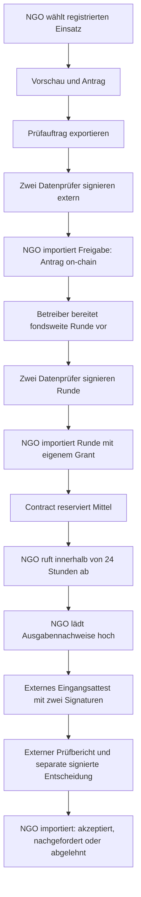
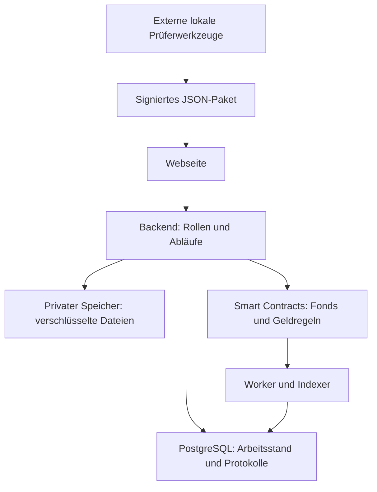

# V3-Landkarte: Funktionen, Rollen und grobe Umsetzung

Stand: 31.10.2026. Abgeglichen mit dem aktuellen Code auf `disasterdao-shared-fund-ui-improvements`, Ausgangscommit `23d16ad`, Repository `NoMelatonin/API3_Hackathon_Agent`. Grundlage ist eine Quellcode- und Dokumentationsprüfung; für diese Landkarte wurden keine neuen Laufzeittests ausgeführt. Frühere Abnahmen stehen in [VERIFICATION.md](VERIFICATION.md).

## 1. Wozu dient die App?

Mehrere NGOs teilen einen Fonds. Eine NGO beantragt Geld für einen registrierten Einsatz. Externe Prüfer bestätigen den Antrag und die Mittelverteilung mit digitalen Signaturen. Die NGO importiert die Freigaben und ruft den reservierten Betrag ab. Anschließend muss sie die Verwendung nachweisen.

Der **Smart Contract** ist das Programm auf der Blockchain, das Fondsbestand, Reservierungen, Freigaben, Auszahlungen und Fristen verwaltet. Die Webseite bedient ihn über einen lokalen Server.

**Organisation/Bündnis** bedeutet in dieser Landkarte einen Zusammenschluss mit gemeinsamem Fonds. Eine **NGO** ist ein einzelnes Mitglied. Aktuell existiert genau ein solches Bündnis mit drei fest registrierten NGOs: Relief North, Health Bridge und Shelter Collective.

**V3 ist ein lokaler Gesamtprototyp.** dUSD sind wertlose Testtoken, die Chain läuft lokal. Organisationen, Rollen, Dokumente und Modellbeispiele sind simuliert. Die historischen V1-Testnet-Nachweise sind keine Nachweise eines produktiven V3-Betriebs.

## 2. Welche Oberfläche ist für wen?

| Einstieg | Zielgruppe und Funktionen | Zuständiger Code |
|---|---|---|
| `/?v3=1#/home` oder `/` | Öffentlichkeit: Organisationen über horizontale Karten entdecken, noch nicht vom Testkonto unterstützte Organisationen sehen, Testspende und Einstellungen öffnen. Kein persönliches Portfolio auf der Startseite. | [home.tsx](../../web/v3/home.tsx), [components.tsx](../../web/v3/components.tsx) |
| `/?v3=1#/organizations/local-alliance` | Organisationsdetail: Fondskennzahlen, Mitglieder, Gebiete, Unterstützungsverlauf des gemeinsamen Testkontos, bestätigte Aktivität und veröffentlichte Berichte. | [organization.tsx](../../web/v3/organization.tsx), [organizations.ts](../../server/organizations.ts) |
| `/?v3=1#/ngo` | NGO-Arbeitsbereich: Fondsübersicht, Antragsassistent und Vorschau, Reservierungen/Abruf, Nachweise, externe Freigaben importieren, fremde Folgeanträge und Mitgliederaktivität ansehen. | [ngo.tsx](../../web/v3/ngo.tsx), [API](../../server/app.ts) |
| `/?v2=1` | Erhaltene V2-Demo mit den älteren Förderkurven; unabhängig vom V3-Arbeitsablauf. V1 bleibt unter `/?legacy=1`. | [web/main.tsx](../../web/main.tsx), [V2-Anleitung](../V2.md) |

Die drei V3-Ansichten haben eigene Routen und Komponenten, teilen aber dieselbe Web-App, Einstellungen und Backend-Infrastruktur. Die Demo ist ein eigener Einstieg. Es gibt **kein Prüferportal mehr**. Alte Links `#public`, `#ngo` und `#alliance-local-alliance` werden weiter aufgelöst; `#review` zeigt einen Hinweis zum externen Prüfablauf.

Das Zahnrad öffnet Sprache, Land, Zeitzone, Währung, Theme, simulierte NGO-Anmeldung und Browserwallet-Verbindung. Die Browserwallet zeigt derzeit nur ihre Adresse an. Sie wird dadurch weder zum Spenderkonto noch zur NGO-Identität.

### Was bedeutet „bisher unterstützt“?

Die Anzeige gehört dem **gemeinsamen lokalen Testkonto 0**, nicht einem persönlich angemeldeten Nutzer. Sie enthält dessen bestätigte Einzahlungen einschließlich Initialfinanzierung. Einzelne NGO-Auszahlungen können nicht einzelnen Spenden zugerechnet werden.

Es existiert nur ein reales Bündnis im lokalen Register. Die Oberfläche erfindet keine weiteren Organisationen. Ohne aktuellen vollständigen Index bleibt der Unterstützungsstatus unbekannt. Die öffentliche Testspende beträgt höchstens 1.000 dUSD je Vorgang; dafür muss eine laufende NGO-Sitzung beendet werden.

## 3. Wer darf was entscheiden?

| Rolle | Aufgabe | Erforderliche Freigabe |
|---|---|---|
| Öffentlichkeit/Testspender | Übersicht ansehen und simulierte Spende auslösen | Keine NGO-Anmeldung. Backend nutzt das feste lokale Spenderkonto. |
| NGO | Eigene Anträge/Nachweise bearbeiten, externe Freigaben importieren und Auszahlung abrufen | Darf sich nicht selbst Mittel genehmigen. Empfänger ist ihre fest registrierte Adresse. |
| Datenprüfer `data-1` bis `data-3` | Anträge und fondsweite Rundensnapshots prüfen; begründete Lageentscheidungen signieren | Mindestens zwei verschiedene Signer der Datengruppe. |
| Nachweisprüfer `evidence-1` bis `evidence-3` | Eingang und Verwendung von Nachweisen, Verlängerungen, bestimmte Folgeanträge und Berichtsveröffentlichung prüfen | Mindestens zwei verschiedene Signer der Nachweisgruppe. |
| Einspruchsprüfer `appeal-1` bis `appeal-3` | Blockierte Nachweisfälle klären, insbesondere nach einem Einspruch | Zwei Signer aus dieser separaten Gruppe. |
| Lokaler Betreiber | Unter anderem fondsweite Runden und externe Prüfaufträge vorbereiten | Kann die erforderlichen Prüfersignaturen nicht durch die Vorbereitung ersetzen. |

„2/3“ heißt **zwei von drei Prüfern**. Die Prüfer arbeiten außerhalb der Browseroberfläche. Das lokale Kommandozeilenwerkzeug simuliert sie mit getrennten festen Schlüsseln; dies belegt keine institutionelle Unabhängigkeit. Prüfer können keine Browsersitzung eröffnen. Befangenheit lässt sich für offene Aufträge dokumentieren.

Umsetzung: [Rollenregister](../../server/state.ts), [externe Freigaben](../../server/external.ts), [CLI-Werkzeug](../../src/v3/approvals.ts), [Contract](../../contracts/DisasterFundV3.sol).

## 4. Wie läuft ein Einsatz vollständig ab?

1. **Bedarf und Antrag:** Die NGO meldet sich über das Zahnrad an, startet den Antragsassistenten und nennt Einsatz, Betrag, Kapazität, externe Finanzierung und Begründung. Die Vorschau zeigt Maximum, Restanspruch, geschätzten Rundenanteil und etwaige Sperren. Sie reserviert kein Geld.
2. **Antrag extern freigeben:** Der Prüfauftrag wird exportiert, zwei Datenprüfer signieren ihn außerhalb der App, die NGO importiert das vollständige JSON-Paket. Der Server prüft es und übermittelt den Contract-Aufruf. Ein eröffneter Antrag ist noch keine Auszahlung.
3. **Runde freigeben:** Der Betreiber bereitet die gemeinsame Verteilung vor. Zwei Datenprüfer signieren den gesamten Snapshot. Eine NGO darf ihn importieren, wenn er einen eigenen Grant enthält. Zwischenzeitliche Änderungen an Budget, Reservierungen oder Ablauf können eine neue Runde und neue Signaturen erfordern.
4. **Abrufen:** Nach der Reservierung ruft die NGO innerhalb von 24 Stunden ab. Das Geld geht an ihre feste Adresse. Nach Ablauf können ungenutzte Reservierungen wieder freigegeben werden.
5. **Ausgaben dokumentieren:** Die NGO lädt Ausgabennachweise zum Auszahlungsdatensatz hoch. TXT muss mit `DISASTERDAO SYNTHETIC` beginnen; alternativ sind PDF/PNG/JPEG mit Dateitypprüfung möglich. Höchstens 2 MiB pro Datei. Zwischenbericht und Ausgabennachweis sind getrennte Inhalte.
6. **Eingang bestätigen:** Ein extern vorbereitetes Eingangsattest erhält zwei Nachweisprüfersignaturen und wird importiert. Es bindet das Manifest der Ausgabennachweise und den rechtzeitigen Eingang. Upload allein reicht nicht.
7. **Verwendung prüfen:** Die NGO lädt den extern erhaltenen Prüfbericht als eigenes Prüfdokument hoch. Ein separater Prüfauftrag bindet diesen Bericht an die signierte Entscheidung. Zwei Nachweisprüfer signieren; die NGO importiert. Mögliche Ergebnisse sind akzeptiert, nachgefordert oder abgelehnt.
8. **Berichten/weiter beantragen:** Nach akzeptiertem oder geklärtem Nachweis kann ein NGO-Bericht zur externen Veröffentlichungsfreigabe eingereicht werden. Folgeanträge benötigen eine neue Bewertung und Datenfreigabe sowie zusätzliche Zustimmung anderer NGOs oder der Nachweisprüfer.

**Ein PDF mit der Aussage „geprüft“ ist keine technische Freigabe.** Dokumentupload und die zwei gültigen Signaturen erfüllen verschiedene Aufgaben. Ebenso sind importiert, gemint, im Index bestätigt und inhaltlich akzeptiert verschiedene Zustände.

Die konkreten Export-/Signier-/Importbefehle stehen in [UI.md](UI.md#externe-freigaben). Dort sind auch Verlängerung, Folgeantrag, Veröffentlichung, Lageentscheidung und Einspruch beschrieben. Der Abschnitt zum Prüferportal in [LOCAL.md](LOCAL.md) beschreibt ausdrücklich den früheren Ablauf.

### Und bei einem ganz neuen Notfall?

Die NGO kann nur einen bereits registrierten Einsatz auswählen. Es gibt noch keinen vollständigen dynamischen Aufnahmeprozess für neue Notfälle oder Mitglieder. Optionale Quellenabfragen erzeugen weder automatisch einen neuen Förderfall noch eine Auszahlung.

Auch in einem akuten Notfall bleibt die externe Freigabe von Antrag und Runde erforderlich. Es gibt keinen separaten V3-Sofortzugriff ohne Prüfer auf freie oder zurückgehaltene Mittel. Das Entfernen des Prüferportals hat die Contract-Regeln nicht gelockert.

## 5. Welche Funktionen sind umgesetzt?

„Umgesetzt“ meint nachfolgend den lokalen simulierten Umfang. Es bedeutet keine Produktivfreigabe oder fachlich validierte Bedarfsprognose.

| Funktion | Erfüllter Umfang und Grenze | Grobe Implementierung |
|---|---|---|
| Entdeckung und Organisationen | Horizontale Karten mit ca. zehnsekündigem Bildwechsel und Kurztext; Bereich für noch nicht unterstützte Bündnisse. Genau ein registriertes Bündnis. Bilder sind lokale synthetische Illustrationen. | [home.tsx](../../web/v3/home.tsx), [components.tsx](../../web/v3/components.tsx), [organizations.ts](../../server/organizations.ts) |
| Fondsübersicht und Aktivität | Fondsvolumen, reservierte/freie Mittel, Mitglieder und normalisierte Chain-Ereignisse; Aktivität seitenweise mit 25 Einträgen. Kein persönliches Spenderportfolio. | [organization.tsx](../../web/v3/organization.tsx), [API](../../server/app.ts), [Organisationstypen](../../src/v3/ui-types.ts) |
| Testspenden | Initial 18.000 dUSD im Fonds und weitere 18.000 beim Testspender; maximal 1.000 pro API-Spende. Browserwallet-Verbindung ändert den Geldgeber nicht. | API `/donations`, Contract `deposit`, [Token](../../contracts/DemoUSDV3.sol) |
| Bedarfsschätzung | Schätzt 30-Tage-Bedarf anhand ähnlicher Ereignisse, erklärt Spanne/Sensitivität. 18 synthetische Vergleichsfälle; mindestens zehn geeignete unabhängige Ereignisse nötig. Ohne Grundlage nur manueller Prüfvorschlag. | [model.ts](../../src/v3/model.ts): `estimate`, `backtest`; [service.ts](../../server/service.ts): `model` |
| Antragsvorschau | Zeigt vorgeschlagenes Maximum, Restanspruch und geschätzte Auszahlung mit derselben Allokationslogik wie die Runde. Keine Zusage oder Reservierung. | [preview.ts](../../server/preview.ts), Service `allocationSnapshot`, NGO-Assistent |
| Anträge und Folgeanträge | Eigene Kapazität, externe Finanzierung, Begründung und dokumentierte Änderungen; kumulative Grenzen. Folgeantrag zusätzlich durch andere berechtigte NGOs oder Nachweisprüfer freizugeben. | Service `submit`, Contract `open`, `vote`, `authorizeFollowup` |
| Externe Freigaben | Signierte JSON-Pakete binden Zweck, Ziel, Chain, Fonds und Daten. Zwei unterschiedliche passende Signer nötig; kein Erzeugen von Ersatzsignaturen beim HTTP-Import. Prüfdokumente werden bei den betreffenden Prüfentscheidungen zusätzlich gebunden. | [external.ts](../../server/external.ts), [approvals.ts](../../src/v3/approvals.ts) |
| Gemeinsame Rundenverteilung | Anteilig nach verbleibendem Bedarf, begrenzt durch Antrag, Kapazität, frühere Auszahlungen, Reservierungen und externe Mittel. Größerer Antrag bedeutet nicht automatisch größeres Gewicht. | [allocation.ts](../../src/v3/allocation.ts), Service `allocationSnapshot`, `prepareRound`; Contract `closeRound` |
| Reserven und Konkurrenz | Pakete ohne Antrag erhalten vorläufige Anteile. Unbekannte/widersprüchliche Lage hält zusätzlich Mittel zurück. | Contract `roundHolds`, `totalReserved`, Allokation |
| Abruf und Sperren | Auszahlung nur nach Freigabe/Reservierung an feste NGO-Adresse; abgelaufene Reservierungen freigebbar. Überfällige oder abgelehnte Nachweise können weitere Abrufe sperren. | Contract `claim`, `release`, `isBlocked` |
| Nachweise und Dokumente | Ausgabennachweis und externes Prüfdokument getrennt; private Downloads, verschlüsselte Speicherung und Dateityp-/Größenkontrollen. Separate Zwischenberichte. | [ngo.tsx](../../web/v3/ngo.tsx), API, [store.ts](../../server/store.ts) |
| Verwendungsprüfung und Konfliktfälle | Eingang, Verwendung, Nachforderung, einmalige Verlängerung, Einspruch und Klärung mit separater Gruppe. NGO sieht eigene Nachweispflichten und Fondsmitgliederaktivität, keine beliebige fremde private Datei. | Contract `receipt`, `review`, `extend`, `appeal`, `resolve`; externe Freigaben |
| Öffentliche Berichte | NGO-Berichte mit Herkunft/Nutzungsrechten/Schutzprüfung; externe 2/3-Veröffentlichungsfreigabe. Eine Veröffentlichung ist keine neue On-Chain-Wirkungsbestätigung. | API-Berichte, `PUBLICATION` in `external.ts`, Organisationsdetail |
| Quellen/Gebietsabdeckung | Signale, klar, unbekannt oder widersprüchlich; fehlende/unvollständige Abfragen gelten nicht als Entwarnung. Begrenzte manuelle Lageentscheidung extern mit 2/3 möglich. | [sources.ts](../../src/v3/sources.ts), [domain.ts](../../src/v3/domain.ts), `COVERAGE`-Import über Betreiberwerkzeug |
| Optionale Live-Abfragen | USGS/EONET-HTTP bei `V3_LIVE_SOURCES=1`, ohne Airnode-Signatur; standardmäßig offline. Weitere Quellen nur im Register, keine vollständige globale Überwachung. | [worker.ts](../../server/worker.ts), Quellenadapter und [Register](../../fixtures/v3/data-register.json) |
| Persistenz und Indexer | Anträge und Dateien bleiben erhalten. Logs/Checkpoint konsistent gespeichert; Fondskennzahlen vom gleichen bestätigten Block. Reorgs werden beim nächsten Indexlauf rekonstruiert. | [store.ts](../../server/store.ts), Worker, `organizations.ts` |
| Status und Erinnerungen | Zeigt lokale Betriebsfehler und Fristerinnerungen. Kein Nachrichtenversand. | Worker und API |
| Sprache, Theme und Bedienung | 39 Sprachoptionen, RTL, 51 Länder, unabhängige Zeitzone/Währung/Theme. DE/EN gepflegt; neue Texte sonst sichtbar englisch, 37 ältere Übersetzungen ungeprüft. Bildpause, Tastaturbedienung und Dialogfokus vorhanden. | [copy.ts](../../web/v3/copy.ts), [i18n.ts](../../web/v3/i18n.ts), Komponenten und Styles |
| Währungsanzeige | Ohne datierten Kurs bleibt andere Modellwährung unbekannt; kein Live-FX und keine dUSD-/Fiat-Umrechnung. | Modell/Formatierung; synthetischer Referenzbetrag ist eine Förderregel |

## 6. Welche Grenzen und Fristen gelten?

| Regel | Bedeutung |
|---|---|
| Maximal 4.500 dUSD je NGO/Einsatz | Kumulative Grenze; tatsächlicher Anspruch kann geringer sein. Bereits gezahlte/reservierte Beträge und externe Mittel zählen mit. |
| 20 % Unsicherheitsreserve | Anteil der freien, noch nicht reservierten Mittel, der bei unbekannter/widersprüchlicher Lage in der Runde zurückbleibt. |
| 90 % bei Konkurrenz/Unsicherheit | Kumulative Grenze bezogen auf das bewertete Maximum je NGO/Einsatz, nicht 90 % des Gesamtfonds. |
| Sechs Stunden | Mindestabstand abgeschlossener Förderrunden; keine automatische Auszahlung alle sechs Stunden. Ein konkreter Rundensnapshot ist höchstens eine Stunde gültig. |
| 24 Stunden | Abruffrist der Reservierung und Bindung vorläufiger Anteile ohne Antrag. |
| 72 Stunden | Frist für zusätzliche Freigabe eines Folgeantrags; danach kann ein nicht ausreichend freigegebener Antrag geschlossen werden. |
| Sieben Tage | Sperre bestimmter unveränderter Wiederholungen. Zwischenbericht separat bis Tag 7 möglich. |
| Reguläre Nachweisfrist | Aktueller Antragspfad: 30 Tage für Erdbeben/Sturm/Flut, 45 bei Gesundheit, 60 bei langsamer Krise. Hilfsfunktion kennt längere Fristen für schwere Fälle; `submit` wählt diese derzeit nicht. |
| Eingangsattest | Rechtzeitiger Eingang muss innerhalb einer Stunde signiert verankert werden. Ein verspäteter Auftrag setzt keine Frist zurück. |
| Nachforderung/Verlängerung | Nachforderung gibt 14 Tage; Verlängerung vor Fälligkeit einmal um höchstens 30 Tage. |
| Einspruch | Innerhalb von 14 Tagen nach Ablehnung; Klärung durch separate Prüfer. |
| Zehn UTC-Werktage | Prüfziel Mo–Fr ohne Feiertagskalender; keine automatische Annahme. |

Regeln: [domain.ts](../../src/v3/domain.ts), [service.ts](../../server/service.ts), [Contract](../../contracts/DisasterFundV3.sol). Maßgeblich sind die Prüfungen und die Zeit auf der Chain.

## 7. Wo liegen die Daten und wozu ist Docker da?

| Bestandteil | Aufgabe und gespeicherte Informationen |
|---|---|
| Webseite | Darstellung und Formulare; Anzeigeeinstellungen lokal im Browser. Keine privaten Prüfschlüssel. |
| Backend/Fastify | Rollen und Signaturimporte prüfen, Vorschläge berechnen, Transaktionen übermitteln und Dateizugriff vermitteln. |
| PostgreSQL | Anträge, Stimmen/Aufträge, Dokumentmetadaten, Berichte und Arbeitszustand als gesperrtes JSONB-Aggregat; separate Audit-/Chain-Logtabellen. |
| S3-kompatibler RustFS | Originaldateien, vor Upload mit AES-256-GCM verschlüsselt. Rollen-/dateigebundene Einmallinks für 60 Sekunden vermitteln private Zugriffe. |
| Lokale Chain/Anvil | Token, verbindliche Fondsregeln, Bewertungen, Reservierungen, Zahlungen und Nachweisstatus; gesalzene Manifeste/Hashes statt Originalbelegen. |
| Worker/Indexer | Chain-Ereignisse mit zwei Blöcken Abstand einlesen, App-Zustand abgleichen, lokale Erinnerungen und optionale Quellenabfragen. |
| Docker Compose | Startet PostgreSQL, RustFS und Anvil mit dauerhaften Volumes. Backend/Webserver laufen zusätzlich als Node-Prozesse. |

Ein **Manifest/Hash** bindet die Dokumentdaten als digitalen Fingerabdruck an einen Vorgang. Es ersetzt weder den Dateispeicher noch eine fachliche Prüfung. Auch eine gültige Signatur beweist zunächst die Zustimmung des Signers, nicht die Lieferung von Hilfsgütern.

Die Datenbank ist für App-Zustand und Ansichten relevant; der Contract prüft die Geldregeln selbst. Die vorgeschlagene Verteilung wird außerhalb des Contracts berechnet und von den Prüfern bestätigt. Datenbank und Chain können nicht als eine gemeinsame atomare Transaktion geschrieben werden; Wiedererkennung und Indexer-Abgleich gehören deshalb zur Umsetzung.

**Warum sehe ich eine Transaktion noch nicht?** Gemint heißt noch nicht im bestätigten Index sichtbar. Anvil erzeugt standardmäßig bei Transaktionen Blöcke; für den Index müssen zwei weitere Blöcke folgen. Der Worker läuft alle 30 Sekunden und erzeugt selbst keine Blöcke. Nur lokal kann zweimal `npm run v3:clock -- --seconds 1` ausgeführt und danach aktualisiert werden. Ein veralteter/unverfügbarer Index wird entsprechend gekennzeichnet.

Normale Neustarts erhalten Datenbank, Dateien und Chain über Docker-Volumes. Sitzungen und Einmallinks verfallen bei Serverneustart. Private Schlüssel liegen in `.runtime/`; verlorene Dateischlüssel machen verschlüsselte Originale unlesbar. Das lokale Authentifizierungs-/Schlüsselkonzept ist nicht für Produktion freigegeben.

Umsetzung: [Docker-Konfiguration](../../compose.v3.yaml), [Start](../../src/v3/start.ts), [Backend](../../server/main.ts), [Chain-Anbindung](../../src/v3/chain.ts), [Speicher](../../server/store.ts).

## 8. Was fehlt noch?

- Dynamische Aufnahme neuer Bündnisse, NGOs und Notfälle; derzeit festes Register, Registrywechsel erfordert einen neuen isolierten Fonds.
- Persönliche Spenderkonten und tatsächliche Spenden aus der verbundenen Browserwallet; der dargestellte Verlauf gehört dem gemeinsamen Testkonto.
- Sofortauszahlung ohne externe Prüferfreigabe; die UI-Änderung hat die Quoren nicht aufgehoben.
- Ein belegtes reales vergleichbares 30-Tage-Ausgabenkorpus und fachliche Validierung des Modells.
- Unabhängige reale NGOs/Prüfer und geeignete Identitäts-, Schlüssel- und Betriebsprozesse. Lokale CLI-Signaturen demonstrieren nur den Mechanismus.
- Produktiver V3-Betrieb und belegte humanitäre Wirkung. Quellenregister, synthetische Dokumente und alte Airnode-Fixtures beweisen diese nicht.

## 9. Welche Anleitung brauche ich?

- **Verstehen:** diese Landkarte.
- **Aktuelle Oberflächen, API und externe Prüfbefehle:** [UI.md](UI.md).
- **Lokalen Stack starten:** [LOCAL.md](LOCAL.md). Die dort ausdrücklich historisch markierten Prüferportal-Schritte nicht als aktuellen Bedienweg verwenden.
- **Frühere Tests und Grenzen:** [VERIFICATION.md](VERIFICATION.md), insbesondere „UI-Weiterentwicklung — 31.10.2026“.
- **Technische Grundentscheidungen:** [IMPLEMENTATION.md](IMPLEMENTATION.md); frühere Portalbeschreibungen beziehen sich auf den ursprünglichen Stand.
- **Projekt und ältere Versionen:** [README](../../README.md).

Diese Landkarte muss bei Änderungen am Verhalten, an Rollen, Oberflächen, Datenflüssen oder Regeln zusammen mit dem Code aktualisiert werden. Pflegevorgabe: [AGENTS.md](../../AGENTS.md).
